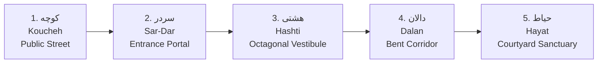

# Hashti Design System (هشتی)

**Hashti** is an enterprise-grade, accessible React component library inspired by the spatial elegance, structural harmony, and dignified hospitality of classical Persian architecture.

Built on **React Aria Components (RAC 1.22.1)**, **Tailwind CSS v4**, and comprehensive design tokens, Hashti serves as the welcoming architectural threshold between complex underlying application logic and intuitive human experience.

```
[API / Data Engine]  ──►  <Hashti />  ──►  [Human Experience]
```

---

## The Persian Architectural Philosophy: هشتی

In traditional Persian vernacular architecture — prominent across the historic desert cities of Isfahan, Yazd, Kashan, and Shiraz — domestic spaces are designed around the concept of **mahramiyat** (محرمیت, sanctuary and privacy) and intentional spatial gradation.

The **Hashti (هشتی)**, derived from the Persian word for eight (_hasht_, هشت), is a vaulted octagonal or polygonal vestibule situated immediately behind the entrance portal. It is never a mere passageway; it is a **deliberate pause**. In the harsh desert climate, the Hashti provides immediate relief from desert heat through thick adobe massing, a zenithal skylight (_hoor-noor_ / هورنور) that bathes the space in diffused soft light, and acoustic serenity that muffles the roar of the bazaar.

In digital design, users often experience sensory overload, abrupt layout shifts, and visual cacophony. Hashti translates this ancient architectural wisdom into software: every component is designed as a balanced, calming threshold that buffers raw data into legible, serene user interfaces.

---

## The 5-Stage Spatial Threshold Sequence

Persian master builders devised an unbroken sequence of five physical transitions between the public city and the private dwelling. In Hashti Design System, this spatial journey maps directly to the layers of user experience:



### 1. کوچه (Koucheh — The Public Street)

- **Architectural Reality:** The narrow, bustling external alleyway flanked by mudbrick walls. High sensory stimuli, continuous movement, social exposure, and harsh sunlight.
- **Digital Translation:** The open internet, raw API payloads, asynchronous WebSocket events, and unauthenticated public endpoints. The chaotic exterior realm of data.

### 2. سردر (Sar-Dar — The Entrance Portal)

- **Architectural Reality:** The monumental pointed ogival arch that announces transition. Embellished with muqarnas (vaulted honeycombing), carved inscriptions, and paired bronze door knockers (_kouveh_ for men with low tone, _halgheh_ for women with high tone). It commands respect and marks an intentional boundary.
- **Digital Translation:** The brand identity, design tokens, entry point routes, authentication gateways, and the iconic 32° ogival arch vector motif.

### 3. هشتی (Hashti — The Octagonal Transitional Vestibule)

- **Architectural Reality:** The octagonal pause chamber. Cool masonry benches (_shahan-shin_ or _sakoo_) line the walls, allowing couriers and guests to sit in comfort without peering into family quarters. Soft zenithal lighting descends from the dome cupola.
- **Digital Translation:** The design system core — our React Aria Component primitive wrappers, theme providers, focus rings, and context providers that normalize runtime data into accessible states.

### 4. دالان (Dalan — The Indirect Bent Passage)

- **Architectural Reality:** A 90-degree bent, winding vaulted hallway connecting the Hashti to the inner courtyard. It mathematically prevents direct lines of sight from the public street into the intimate residential chambers.
- **Digital Translation:** Nested layered elevation (`Layer` level 1, 2, 3), contextual drawer overlays, modal sheets, and defense against layout shifts that shield user attention and maintain state integrity.

### 5. حیاط (Hayat — The Courtyard Sanctuary)

- **Architectural Reality:** The destination: a sun-drenched central courtyard garden anchored by a turquoise reflecting pool (_howz_ / حوض), surrounded by pomegranates, bitter orange trees, and harmonious living rooms (_panj-dari_).
- **Digital Translation:** The finished application interface: tranquil, accessible, balanced, responsive, and delightful for the human being using it.

---

## Mathematical Vector Geometry

The Hashti brand mark is constructed from **3 concentric arches** reflecting authentic Safavid and Seljuk masonry geometry:

- **Arch Pitch:** 32° ogival pointed arch angle, derived from classic Persian four-centered and pointed vault drafting techniques.
- **Stroke Width:** Exact **16px** stroke weight on master display scales.
- **Clearance Gap:** Uncompromising **14px** negative space clearance gap between concentric arches.
- **Golden Ratio Cadence:** 1:1.618 dimensional proportion between the central gateway anchor and the flanking exterior vaults.

```
       ▲  32° Ogival Crown
      / \
     /   \      Concentric Arches (16px Stroke / 14px Gap)
    /  ▲  \
   /  / \  \
  |  |   |  |
  |  | █ |  |   Gateway Anchor
══╧══╧═══╧══╧══ Baseline
```

---

## Core Architectural Pillars

Hashti is grounded in four non-negotiable engineering and aesthetic pillars:

| Pillar              | Principle                                                     | Standard                                                                                                                                                     |
| :------------------ | :------------------------------------------------------------ | :----------------------------------------------------------------------------------------------------------------------------------------------------------- |
| **✦ Accessible**    | Universal access is foundational, never retrofitted.          | **WCAG 2.2 AAA Compliance**: Strict 7:1 minimum contrast on all body text, full keyboard roving tabindex, escape handling, and screen reader announcements.  |
| **◈ Elegant**       | Inspired by Persian spatial harmony and monochrome restraint. | **Geometric Proportion**: Pure obsidian and chalk contrast accented by Persian turquoise, Isfahan amber, and terracotta clay on an 8-point spatial grid.     |
| **⚡ Open Source**  | Community-owned, transparent, and permissive.                 | **Apache 2.0 License**: High-performance Bun runtime velocity, clean TypeScript types, zero telemetry, and modular tree-shakeable packaging.                 |
| **⇄ International** | True bidirectional symmetry across languages and cultures.    | **Dual-Engine LTR/RTL**: Native pairing of **Vazirmatn** (crafted for flawless Nastaliq-informed Persian reading) and **Satoshi** (modern Latin sans-serif). |

---

## Documentation Navigation

Explore the core areas of Hashti Design System:

- 🚀 [Installation Guide](/docs/getting-started/installation): Quickstart with Bun, npm, pnpm, or yarn across Next.js, Astro, and Vite.
- 🎨 [Theming Architecture](/docs/getting-started/theming): Explore the 8 supported themes across Core 4, Relay, and Frame.
- ♿ [Accessibility & RTL](/docs/getting-started/accessibility): Deep dive into WCAG 2.2 AAA compliance and bidirectional Persian/Arabic layout.
- 💎 [Color Tokens](/docs/foundations/colors): Discover Obsidian Black, Persian Turquoise, Isfahan Amber, and semantic tokens.
- 🔤 [Typography](/docs/foundations/typography): Satoshi, Vazirmatn, and JetBrains Mono typographic hierarchy.
- 📐 [Spacing & Geometry](/docs/foundations/spacing-geometry): 8-point spatial grid, control heights, and arch curves.
- 🏛️ [Hashti Brandbook](/docs/foundations/brandbook): Identity presentation sheet, SVG vector assets, and live interactive showcase.
- 🗺️ [RAC Expansion Roadmap](/docs/roadmap/rac-expansion): Comprehensive elevation plan for React Aria Components 1.22.1.
