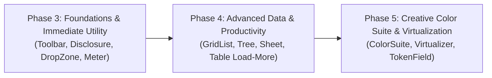
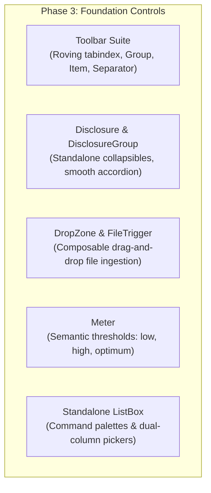

# RAC 1.22.1 Component Expansion Roadmap

Hashti combines **Carbon Design System's** disciplined enterprise geometry, **React Aria Components' (RAC 1.22.1)** battle-tested W3C WAI-ARIA behavioral foundation, and **Frame's** brand aesthetic.

Currently, Hashti exports 45 polished component families. However, `react-aria-components@1.22.1` offers powerful low-level capabilities that are either raw re-exports, trapped inside monolithic wrappers, or unexposed. This roadmap outlines Hashti's phased architecture plan to systematically elevate these primitives into first-class, theme-aware, accessible building blocks.



---

## Architectural Principles (HeroUI v3 Elevation Model)

Following the design craft established in HeroUI v3 and modern React 19 standards, Hashti elevates every RAC primitive using six structural guarantees:

1. **React 19 Ref-as-Prop & Compound Namespacing:** No boilerplate `forwardRef`. Components export ergonomic namespaces (e.g. `Toolbar.Root`, `Toolbar.Group`, `Toolbar.Item`) using `Object.assign`.
2. **Contextual Compound Slot Distribution:** Container states (`size`, `variant`, `isDisabled`, `orientation`) propagate downwards through typed React Contexts without prop drilling.
3. **Defensive Exit Animation Lifecycle (`useOverlayExitHold`):** WebKit and Safari layout-effect race conditions are guarded using active animation probes and `flushSync` unmounting to eliminate 1-frame opacity flashes.
4. **Collection Slot Injection (`createCollectionSlot`):** Preserves RAC's `CollectionBuilder` AST while cleanly supporting sticky headers, empty states, and custom decorative scrollbars.
5. **Accessible Clearable Actions:** Clear triggers avoid nested `<button>` anti-patterns, rendering presentation spans with pointer event isolation and keyboard interceptors (<kbd>Backspace</kbd>/<kbd>Delete</kbd>).
6. **Multi-Theme Token Fidelity:** Direct CSS variable bindings across all 8 themes (`white`, `g10`, `g90`, `g100`, `relay-light`, `relay-dark`, `frame-light`, `frame-dark`) and 3 layer depths.

---

## Phased Component Breakdown

### Phase 3: Immediate High-Impact Controls (Foundation & Utilities)

Phase 3 targets fundamental layout and workflow primitives required across enterprise dashboards and editors.



#### 1. Toolbar Suite (`Toolbar`)
- **Motivation:** Replaces raw RAC re-export with an accessible tool ribbon providing roving `tabindex`, horizontal/vertical orientations, button group wrappers, and dividers.
- **Subcomponents:** `Toolbar.Root`, `Toolbar.Group`, `Toolbar.Item`, `Toolbar.Separator`.
- **Keyboard Contract:** Single tab stop. Arrow keys move between tools; <kbd>Home</kbd> and <kbd>End</kbd> jump to boundaries.

#### 2. Disclosure & DisclosureGroup (`Disclosure`)
- **Motivation:** Extends the internal logic of `Accordion` into a standalone, single-panel collapsible control (e.g., for "Advanced Settings" sections in cards and forms).
- **Subcomponents:** `Disclosure.Root`, `Disclosure.Trigger`, `Disclosure.Panel`.
- **Features:** Hardware-accelerated CSS grid height animations (`grid-template-rows: 0fr -> 1fr`), custom indicator icons, and lazy content mounting.

#### 3. DropZone & FileTrigger
- **Motivation:** Decouples file ingestion from the monolithic `FileUploader` wrapper. Developers can turn any custom card, canvas, or table row into an accessible drop target.
- **Anatomy:**
  ```tsx
  <DropZone onDrop={handleFiles}>
    <FileTrigger acceptedFileTypes={["image/png", "image/svg+xml"]}>
      <Button variant="secondary">Upload Vector Asset</Button>
    </FileTrigger>
    <Text slot="label">or drag and drop files here</Text>
  </DropZone>
  ```

#### 4. Semantic Meter (`Meter`)
- **Motivation:** Elevates the generic progress bar into a true semantic gauge supporting W3C `<meter>` semantics with explicit threshold ranges (`low`, `high`, `optimum`).
- **Dynamic Color Tone:** Automatically switches tokens from Success (Turquoise/Emerald) to Warning (Amber) or Critical (Terracotta) as values traverse thresholds.

---

### Phase 4: Advanced Data & Productivity Workflows

Phase 4 delivers mission-critical controls for organizing and navigating complex, deeply nested datasets.

#### 1. GridList (`GridList`)
- **Carbon Alignment:** Elevates Carbon’s **ContainedList** to RAC’s accessible grid specification.
- **Key Features:**
  - Roving arrow-key navigation with multi-item selection (<kbd>Shift</kbd>+<kbd>Click</kbd>, <kbd>Cmd</kbd>+<kbd>A</kbd>).
  - Drag-and-drop item reordering handles with accessible keyboard reordering (<kbd>Alt</kbd>+<kbd>Arrow Up/Down</kbd>).
  - Infinite scroll trigger (`GridList.LoadMore`) and custom empty state slots.
- **Row Heights:** `sm: 36px`, `md: 44px (Frame standard)`, `lg: 56px`.

#### 2. Tree & TreeView (`Tree`)
- **Motivation:** Dedicated hierarchical navigator for file systems, organization charts, code AST explorers, and documentation sidebars.
- **Anatomy:**
  ```tsx
  <Tree aria-label="Project Structure" selectionMode="multiple">
    <Tree.Item id="src" textValue="src">
      <Tree.Chevron />
      <Tree.Content>src</Tree.Content>
      <Tree.Item id="components">
        <Tree.Chevron />
        <Tree.Content>components</Tree.Content>
      </Tree.Item>
    </Tree.Item>
  </Tree>
  ```
- **Accessibility:** Full `treegrid` semantics with guide lines, automated branch expansion, and asynchronous dynamic child loading.

#### 3. Sheet (`Sheet`)
- **Motivation:** Integrates RAC 1.22's native mobile bottom sheet and sliding side panel.
- **Features:** Smooth velocity gesture dragging, snap points (e.g. `25%`, `50%`, `90%`, `full`), backdrop dimming, and viewport-aware responsive breakpoints.

#### 4. Resizable Table & Infinite Scroll
- **Enhancements:** Introduces `TableLoadMoreItem` for infinite datasets and elevated `ColumnResizer` handles with keyboard nudging (<kbd>Arrow Left/Right</kbd>) and minimum width snapping.

---

### Phase 5: Creative Color Suite & High-Scale Virtualization

Phase 5 equips Hashti for specialized creative tooling, canvas design apps, and massive data scale.

#### 1. Color Suite (`ColorSuite`)
A comprehensive, accessible 8-component suite for parsing, selecting, and manipulating colors in CSS formats (Hex, RGB, HSL, HSB):

| Component | Responsibility |
| :--- | :--- |
| `ColorPicker` | Top-level coordinator popover combining swatch trigger and multi-channel editor. |
| `ColorArea` | 2D saturation/value surface with 2-axis keyboard thumb. |
| `ColorSlider` | 1D channel slider with dynamic gradient track (Hue, Alpha, Lightness). |
| `ColorWheel` | 360° circular hue selector with circular drag constraints. |
| `ColorField` | Format-aware text input with automated validation and unit parsing. |
| `ColorSwatch` | Color preview tile with transparency checkerboard background. |
| `ColorSwatchPicker` | Accessible grid of pre-defined palette swatches. |
| `ColorThumb` | Dual-ring high-contrast drag handle adhering to WCAG focus standards. |

#### 2. Virtualizer (`Virtualizer`)
- **Integration:** Powered by `@react-aria/virtualizer` for `Table`, `GridList`, and `ListBox`.
- **Target Performance:** Renders **100,000+ items** smoothly at 60fps with sub-16ms layout calculations, dynamic row height measurement, and minimal memory footprint.

#### 3. TokenField (`TokenField`)
- **Description:** Multi-token tag input field supporting keyboard deletion, drag sorting, email validation, and async search suggestions.

---

## Production Verification & Quality Gates

Every elevated component must satisfy Hashti’s four non-negotiable release gates before merging into `@hashti/react`:

### 1. Automated Accessibility Audit (Axe Core)
- **Zero Violations:** Automated clean sweep across `color-contrast`, `aria-roles`, `aria-allowed-attr`, `aria-required-children`, and `nested-interactive`.
- **Live Region Announcements:** Status changes and drag reordering must announce cleanly through polite live regions (`aria-live="polite"`).

### 2. RTL & Internationalization Parity
- **Linguistic Symmetry:** Zero margin/padding inversions using hardcoded `left`/`right`. Components must use CSS logical properties (`margin-inline-start`, `padding-inline-end`).
- **Typography:** Seamless font switching to **Vazirmatn** under Persian/Arabic locales with verified baseline alignment.

### 3. Token & Theme Fidelity
- **8-Theme Test Suite:** Visual regression confirmation across all 8 themes (`white`, `g10`, `g90`, `g100`, `relay-light`, `relay-dark`, `frame-light`, `frame-dark`).
- **3-Layer Depth:** Verification that surfaces, borders, and text maintain required contrast across Layer 0, Layer 1, and Layer 2.

### 4. Bundle Efficiency
- **Strict Tree-Shaking:** Components must remain independently importable without pulling unneeded dependencies.
- **Target Footprint:** Zero runtime CSS-in-JS dependencies; prebuilt CSS classes bound directly to CSS variables.
