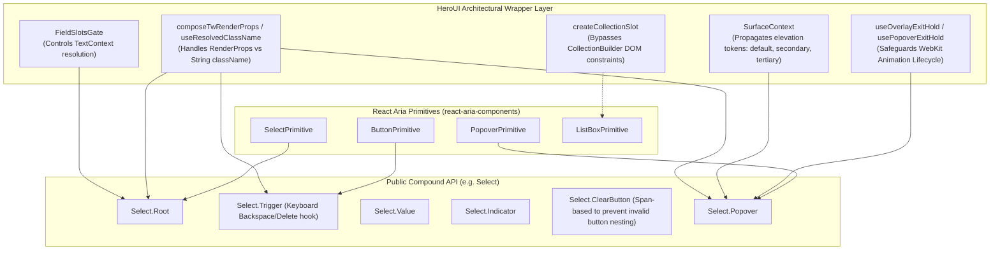
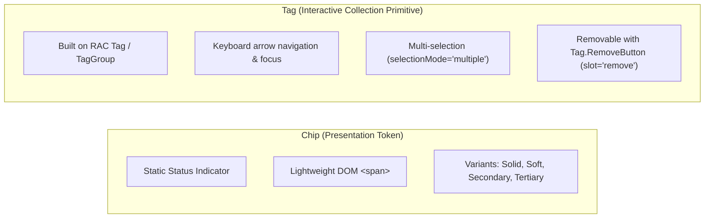

# HeroUI Design System Deep-Dive: Architecture, Craftsmanship & Elevation Blueprint for Cinder

> **Investigation Target:** `/Users/ramin/Documents/Projects/Personal/heroui` (HeroUI v3 branch)  
> **Target Integration:** Cinder Design System (`/Users/ramin/Documents/Projects/Personal/cinder`)  
> **Focus Areas:** React Aria Components (RAC) wrapping patterns, component anatomy, visual micro-interactions, motion physics, and theming craftsmanship.

---

## Executive Summary

HeroUI v3 represents a major architectural leap over its predecessor (v2/NextUI), completely migrating to **React Aria Components (RAC)** as its accessible foundation and **Tailwind CSS v4** with **BEM-styled component tokens** for its visual layer.

Unlike shallow UI libraries that merely slap CSS classes on basic DOM elements, HeroUI addresses the deepest architectural and rendering quirks of modern browsers and React Aria—from **WebKit CSS animation timing bugs** on overlay unmounts to **zero-runtime CSS Scroll-Driven Animations**, **synchronized multi-skeleton shimmers via CSS `:has()` and mix-blend-mode**, and **true SVG crescent masking on overlapping avatars**.

This investigation explores the codebase in detail to extract the core architectural patterns, novel components, and craftsmanship techniques that Cinder can adopt and elevate.

---

## 1. React Aria Components (RAC) Wrapping Architecture

HeroUI wraps React Aria Components with a consistent, robust architectural paradigm that combines compound component composition, React 19 patterns, and defensive DOM handling.



### 1.1 Compound Architecture & React 19 Ref Handling

- **React 19 ref-as-prop:** HeroUI abandons legacy `forwardRef` wrappers across v3 components, directly accepting `ref` as a standard prop on component signatures (`{children, className, ref, ...props}`).
- **Static Compound Namespacing:** Components are assembled using `Object.assign`, exporting both named subcomponents and namespaced properties:
  ```tsx
  export const Select = Object.assign(SelectRoot, {
    Root: SelectRoot,
    Trigger: SelectTrigger,
    Value: SelectValue,
    Indicator: SelectIndicator,
    ClearButton: SelectClearButton,
    Popover: SelectPopover,
    Item: ListBoxItem,
    Section: ListBoxSection,
  });
  ```
- **Contextual Slot Distribution:** Each component creates an internal React Context (`SelectContext`, `ModalContext`, `CardContext`) holding a memoized instance of the Tailwind Variants slot generator: `slots = useMemo(() => selectVariants({...}), [...])`. Sub-parts consume this context to apply their specific BEM element class.

### 1.2 Resolving `className`: Render Props vs. String Components

React Aria primitives vary in their `className` type signature: some accept a function `(renderProps: T) => string` (e.g. `Button`, `Popover`, `Input`), while others only accept a static `string` (e.g. `Heading`, `Dialog`). HeroUI standardizes this with three utilities (`packages/react/src/utils/compose.ts`):

- `composeTwRenderProps(className, tailwind)`: Wraps RAC's `composeRenderProps`, evaluating both user functions and base variant classes, deduplicating through `tailwind-variants` (`cx`).
- `useResolvedClassName(className, styles)`: Dynamically checks if `className` is a function; if so, uses `composeTwRenderProps`; if a string, merges with `cx(styles, className)`.
- `composeSlotClassName(slotFn, className, variants)`: For DOM-only subcomponents that accept standard JSX elements.

### 1.3 The WebKit Exit Animation Bug & `useOverlayExitHold`

One of the most profound innovations in HeroUI v3 is `packages/react/src/utils/use-overlay-exit-hold.ts` (and its wrapper `use-popover-exit-hold.ts`).

#### The Problem:

In React Aria, overlays with exit animations rely on the `isExiting` state. When closing, RAC sets `data-exiting="true"` and checks whether CSS animations are `running`. On WebKit / Safari:

1. CSS animations applied when an attribute changes often remain in a `pending` state during the layout effect pass. React Aria sees no running animation and unmounts the DOM node immediately.
2. If an overlay has `animation-fill-mode: none`, as soon as the animation completes, the element computes back to `opacity: 1` for one frame before React removes it from the DOM, causing a visible flicker.

#### HeroUI's Solution:

`useOverlayExitHold` manages the overlay lifecycle:

1. When `isOpen` transitions to `false`, it holds `isExiting = true`.
2. It inspects running animations using `element.getAnimations({subtree: true})` and queries duration using `getComputedStyle(element).animationDuration`.
3. If no animation is running yet, it sets up an `animationend` / `animationcancel` listener, backed by a safety `window.setTimeout(duration + 50ms)` and `requestAnimationFrame`.
4. Before unmounting, it pins `opacity: 0` inline across all exiting elements (`finishBeforePaint`) and executes `flushSync(endExit)`, guaranteeing zero flicker.

### 1.4 Bypassing RAC CollectionBuilder Restrictions: `createCollectionSlot`

React Aria's collection components (`Tabs`, `ListBox`, `Menu`, `TagGroup`) use a compiler-like `CollectionBuilder` that traverses direct JSX children to construct internal collections. Inserting a simple wrapper `<div>` around items breaks the collection traversal.
HeroUI created `createCollectionSlot` (`packages/react/src/utils/collection-prop-injection.tsx`):

- It creates an injection channel using a string-keyed cloned prop (`$$heroui.collection.<name>`) and a React Context (avoiding Symbol keys which React strips during element cloning).
- The collection target consumes the slot via RAC's `render` prop or a `withSlot` Higher-Order Component, allowing external containers and chrome without breaking RAC's virtual tree builder.

### 1.5 The Span-vs-Button Dilemma in Clearable Inputs

In `Select`, `ComboBox`, and `Input`, providing a clear button inside the trigger poses an accessibility hazard:

- Nesting a `<button>` inside `<Select.Trigger>` (which renders an HTML `<button>`) is **invalid HTML** and breaks browser accessibility trees.
- Solution: `SelectClearButton` renders a `<dom.span aria-hidden>` with `onPointerDown={(e) => e.stopPropagation()}` so clicking it does not toggle the menu.
- Keyboard Support: Because a non-focusable span cannot receive keyboard focus, `Select.Trigger` intercepts `Backspace` and `Delete`. If a clear button is mounted (tracked via a reference count in `SelectContext`), hitting Backspace or Delete on the closed select trigger clears the selection.

---

## 2. Standout & Novel Components

| Component                | Architecture & Underlying Primitive                                         | Core UX & Visual Highlights                                                                                                                                       |
| ------------------------ | --------------------------------------------------------------------------- | ----------------------------------------------------------------------------------------------------------------------------------------------------------------- |
| **Avatar & AvatarGroup** | Radix Avatar Primitive + Custom Masking Engine                              | Transparent crescent cutout mask (`mask: ... exclude/add`) with RTL invert & optical fallback text nudge; `max` count pill; Grid mode.                            |
| **Badge**                | Custom DOM compound (`Badge.Anchor`, `Badge.Root`, `Badge.Label`)           | Floating offset positions (`translate(±25%, ±25%)`), dot indicator mode, `background-clip: padding-box` perimeter cutout.                                         |
| **Card**                 | Surface-aware container (`Card.Header`, `Card.Title`, `Card.Content`, etc.) | Automatically sets `SurfaceContext`, enabling child controls to know their elevation level; `border-radius: min(32px, var(--radius-3xl))`.                        |
| **Chip vs. Tag**         | `Chip` = Presentation pill; `Tag` = Interactive RAC primitive               | `Chip` offers solid/soft/secondary/tertiary badges; `Tag` integrates with `TagGroup` multi-selection, keyboard navigation, and close triggers.                    |
| **InputOTP**             | `input-otp` primitive + RAC `FieldErrorContext`                             | Bouncing digit entry animation (`slot-value-in`), blinking caret, fake caret support, grouping and separator dashes.                                              |
| **ScrollShadow**         | CSS `@property` + CSS Scroll-Driven Animations                              | Zero-JS scroll fade hints on the GPU compositor; automated JS fallback for older browsers; full RTL directional swapping.                                         |
| **Drawer vs. Sheet**     | `Drawer` = Modal/Dialog slide-over; `Sheet` = RAC Sheet primitive           | Drawer features 4-axis velocity tracking (`useDrawerDrag`); Sheet features snap points, iOS spring curve `(0.32, 0.72, 0, 1)`, and stacked background scale-down. |
| **Kbd**                  | Native `<kbd>` + semantic `<abbr>`                                          | Maps keyboard shortcut keys (`command`, `shift`, `option`, etc.) to unicode symbols (`⌘`, `⇧`, `⌥`) with accessible screen-reader titles.                         |
| **EmptyState**           | Semantic message wrapper                                                    | Clean standardized empty state with slot styling, designed to slot into RAC collections (`ListBox`, `Table`, `ComboBox`).                                         |
| **User**                 | Avatar + Typography composition pattern                                     | Replaces rigid monolithic User cards with composable Avatar + name/subtitle blocks with hover and press integration.                                              |

---

### 2.1 Avatar & AvatarGroup

HeroUI v3 replaces simple bordered avatar stacks with a mathematical CSS masking layout in `packages/styles/components/avatar-group.css`:

#### The "Clip" Crescent Overlap

Most UI kits achieve avatar stacking by applying a solid border matching the background color (`box-shadow: 0 0 0 2px var(--background)`). This fails on gradients, images, glassmorphism, or colored cards.
HeroUI's `overlap="clip"` mode calculates an exact crescent cut-out using CSS mask compositing:

```css
.avatar-group--clip:not(.avatar-group--grid) > .avatar:not(:last-child) {
  --avatar-group-cut-size: calc(var(--avatar-size, 2.5rem) + 2 * var(--avatar-group-seam, 2px));
  --avatar-group-cut-radius: calc(
    min(
        var(--avatar-radius, calc(var(--avatar-size, 2.5rem) / 2)),
        calc(var(--avatar-size, 2.5rem) / 2)
      ) +
      var(--avatar-group-seam, 2px)
  );
  --avatar-group-cut-diameter: calc(2 * var(--avatar-group-cut-radius));
  --avatar-group-cut-span: calc(var(--avatar-group-cut-size) - var(--avatar-group-cut-diameter));
  --avatar-group-cut-x: calc(
    var(--avatar-size, 2.5rem) - var(--avatar-group-overlap, 0.5rem) - var(--avatar-group-seam, 2px)
  );
  --avatar-group-cut-y: calc(-1 * var(--avatar-group-seam, 2px));
  --avatar-group-cut-fill: linear-gradient(#000 0 0);
  --avatar-group-cut-arc: radial-gradient(circle closest-side, #000 99%, #0000);

  mask:
    var(--avatar-group-cut-fill) 0 0 / 100% 100% no-repeat exclude,
    var(--avatar-group-cut-fill) calc(var(--avatar-group-cut-x) + var(--avatar-group-cut-radius))
      var(--avatar-group-cut-y) / var(--avatar-group-cut-span) var(--avatar-group-cut-size)
      no-repeat add,
    var(--avatar-group-cut-fill) var(--avatar-group-cut-x)
      calc(var(--avatar-group-cut-y) + var(--avatar-group-cut-radius)) /
      var(--avatar-group-cut-size) var(--avatar-group-cut-span) no-repeat add,
    var(--avatar-group-cut-arc) var(--avatar-group-cut-x) var(--avatar-group-cut-y) /
      var(--avatar-group-cut-diameter) var(--avatar-group-cut-diameter) no-repeat add,
    var(--avatar-group-cut-arc) calc(var(--avatar-group-cut-x) + var(--avatar-group-cut-span))
      var(--avatar-group-cut-y) / var(--avatar-group-cut-diameter) var(--avatar-group-cut-diameter)
      no-repeat add,
    var(--avatar-group-cut-arc) var(--avatar-group-cut-x)
      calc(var(--avatar-group-cut-y) + var(--avatar-group-cut-span)) /
      var(--avatar-group-cut-diameter) var(--avatar-group-cut-diameter) no-repeat add,
    var(--avatar-group-cut-arc) calc(var(--avatar-group-cut-x) + var(--avatar-group-cut-span))
      calc(var(--avatar-group-cut-y) + var(--avatar-group-cut-span)) /
      var(--avatar-group-cut-diameter) var(--avatar-group-cut-diameter) no-repeat add;
}
```

- **Optical Nudge:** Because a circular piece is cut out of the right side of the avatar, fallback initials look off-center. HeroUI compensates with `padding-inline-end: calc(var(--avatar-group-overlap, 0.5rem) * 0.35);`.
- **RTL Support:** In RTL layouts (`:dir(rtl)`), the cut-out geometry seamlessly flips to the opposite side.

---

### 2.2 Badge

HeroUI's Badge supports both floating notification badges and status indicator dots:

- **`Badge.Anchor`**: Wraps the parent element (e.g. an Avatar or Button) with `position: relative`.
- **Placement Offsets:** `top-right`, `top-left`, `bottom-right`, `bottom-left` positioned with `translate(±25%, ±25%)` so the center of the badge aligns with the perimeter of the child.
- **Background Clip Cutout:** `border: 1px solid var(--badge-border)` combined with `background-clip: padding-box` produces an automatic visual knockout ring around the badge.
- **Auto-Formatting:** Strings and numbers are automatically wrapped in `<Badge.Label>`; if `children` is empty, the badge scales down to a standalone status dot.

---

### 2.3 Card & Surface Elevation

The Card component acts as the foundational container for content blocks:

- **Subcomponent Suite:** `Card.Root`, `Card.Header`, `Card.Title`, `Card.Description`, `Card.Content`, `Card.Footer`.
- **Elevation Awareness:** Card provides `<SurfaceContext value={{variant}}>`, passing its elevation state (`default`, `secondary`, `tertiary`) down to inputs, buttons, and badges placed inside it.
- **Corner Curvature:** Uses `border-radius: min(32px, var(--radius-3xl))` ensuring squircle-like modern rounding that never exceeds the container's half-height.

---

### 2.4 Chip vs. Tag: The Clear Architectural Separation

Many design systems conflate chips and tags. HeroUI separates them by purpose and interactivity:



- **Chip:** Ideal for category badges, pill labels, and metadata.
- **Tag:** Ideal for filter bars, multi-select input tokens, tokenized search queries, and removable tag sets.

---

### 2.5 InputOTP (One-Time Password / 2FA Code Input)

HeroUI wraps the headless `input-otp` library with RAC validation semantics:

- **RAC Bridge:** Wraps the control in `FieldErrorContext`, allowing RAC forms to manage validation errors on OTP fields.
- **Micro-Animations:** When a digit is typed, it enters with a bouncy vertical transition:
  ```css
  @keyframes slot-value-in {
    0% {
      opacity: 0;
      transform: translateY(8px) scale(0.8);
    }
    100% {
      opacity: 1;
      transform: translateY(0) scale(1);
    }
  }
  ```
- **Blinking Caret:** When a slot is active, an absolute 2px simulated cursor pulses (`animate-caret-blink`), matching native mobile text inputs.

---

### 2.6 ScrollShadow: CSS Scroll-Driven Animations

Instead of attaching scroll event listeners in JavaScript (which cause main-thread scroll jank), HeroUI leverages modern CSS Scroll-Driven Animations via CSS `@property`:

```css
@property --scroll-shadow-start-fade {
  syntax: "<length>";
  inherits: false;
  initial-value: 0px;
}

@property --scroll-shadow-end-fade {
  syntax: "<length>";
  inherits: false;
  initial-value: 0px;
}

@keyframes scroll-shadow-start-fade {
  from {
    --scroll-shadow-start-fade: 0px;
  }
  to {
    --scroll-shadow-start-fade: var(--scroll-shadow-size);
  }
}

@keyframes scroll-shadow-end-fade {
  from {
    --scroll-shadow-end-fade: var(--scroll-shadow-size);
  }
  to {
    --scroll-shadow-end-fade: 0px;
  }
}
```

- **Zero JS on Modern Browsers:** The browser's GPU compositor applies the fade mask during scrolling without running a single line of JavaScript.
- **Graceful Fallback:** In older browsers or controlled mode (`visibility="top" | "bottom"`), a lightweight `useScrollShadow` hook falls back to updating `data-top-scroll` and `data-bottom-scroll` attributes.
- **RTL Aware:** Horizontal scroll shadows swap gradient directions automatically under `:dir(rtl)`.

---

### 2.7 Drawer vs. Sheet: Two Distinct Sliding Overlay Paradigms

HeroUI provides both Drawer and Sheet, each tailored to distinct UX requirements:

#### A. Drawer (`packages/react/src/components/drawer/`)

- Built on top of RAC `Modal` and `Dialog`.
- Ideal for classic application sidebars, filter panels, and slide-overs from 4 directions (`top`, `bottom`, `left`, `right`).
- Custom `useDrawerDrag` hook tracks pointer velocity and drag delta: dragging >30% or flicking with velocity >0.5 px/ms dismisses the drawer with a spring release.

#### B. Sheet (`packages/react/src/components/sheet/`)

- Built on RAC `Sheet`.
- Ideal for mobile bottom sheets and action panels.
- **Snap Points:** Accepts `snapPoints?: (number | string)[]` (e.g. `[200, "50%", 1]`) allowing partial resting heights.
- **iOS Spring Motion:** Easing curve `cubic-bezier(0.32, 0.72, 0, 1)` with 500ms duration.
- **Nested Sheets & Background Scaling:** Includes `Sheet.NestedRoot` with a backdrop scaling animation (`heroui-sheet-scale-back`), scaling down the background screen when the sheet slides up, mirroring iOS native modal sheets.
- **Detached Mode:** `isDetached` floats the sheet with margins away from the viewport edge.

---

### 2.8 Kbd (Keyboard Keycap)

- **Accessible Semantics:** Emits native `<kbd>` enclosing `<abbr title="Command">⌘</abbr>`.
- **Glyph Dictionary:** Standardizes key representations across macOS, Windows, and Linux:
  - `command: "⌘"`, `shift: "⇧"`, `ctrl: "⌃"`, `option: "⌥"`, `enter: "↵"`, `delete: "⌫"`, `escape: "⎋"`, `tab: "⇥"`, `space: "␣"`.
- **Variants:** `default` (raised surface with subtle border) and `light` (transparent background for clean placement inside search bars and command palettes).

---

### 2.9 User (Avatar + Identity Composition)

In v2, HeroUI had a monolithic `<User name="..." description="..." avatarProps={{...}} />`. In v3, they removed the monolith in favor of manual composition with `<Avatar>` and typography classes.

#### Recommendation for Cinder:

While removing the monolithic component eliminated prop drilling, manual composition often leads to inconsistent spacing and typography across different screens. Cinder should build a **compound `<User>` component**:

```tsx
<User.Root>
  <User.Avatar src="..." fallback="RC" />
  <User.Details>
    <User.Name>Ramin</User.Name>
    <User.Description>Design Engineer</User.Description>
  </User.Details>
</User.Root>
```

---

## 3. Visual Craftsmanship, Motion & Theming

### 3.1 Press Physics & Micro-Interactions

HeroUI achieves an exceptionally responsive, tactile feel through tuned active scaling:

```css
.button {
  transition:
    transform 250ms var(--ease-smooth),
    background-color 100ms var(--ease-out),
    box-shadow 100ms var(--ease-out);
  @apply transform-gpu motion-reduce:transition-none;

  &:active,
  &[data-pressed="true"] {
    @apply will-change-transform;
    transform: scale(0.97);
  }
}

/* Size-compensated scaling */
.button--sm:active {
  transform: scale(0.98);
} /* Subtler squish on small targets */
.button--lg:active {
  transform: scale(0.96);
} /* More noticeable squish on large targets */
```

#### Key Details:

- **`will-change-transform` only on active/pressed:** Prevents browser GPU layer bloat during idle state, activating GPU compositing only when the user presses down.
- **Size compensation:** Small elements feel overly distorted at 0.97, so 0.98 is used; larger elements require 0.96 to feel equally tactile.
- **`no-highlight` & `select-none`:** Eliminates mobile browser tap-highlight flashes (`-webkit-tap-highlight-color: transparent`).

---

### 3.2 Glassmorphism & GPU Mobile Safeguards

Overlays feature modern backdrop blurs (`backdrop-blur-md`), but HeroUI introduces an essential performance safeguard:

```css
.modal__backdrop--blur {
  @apply bg-backdrop backdrop-blur-md;

  /*
   * A full-viewport backdrop-filter stalls mid-range mobile GPUs long enough
   * that the open animation is skipped. Keep the dim scrim.
   */
  @media (hover: none) and (pointer: coarse) {
    -webkit-backdrop-filter: none;
    backdrop-filter: none;
  }
}
```

> [!IMPORTANT]
> Full-viewport backdrop filters on mobile devices (A14/iPhone 12 and mid-range Android devices) cause heavy GPU pipeline stalls. The 150ms opening animation finishes before the GPU can render the blurred frame, resulting in dropped frames and a jarring pop-in. Disabling `backdrop-filter` on touch devices while keeping the dimmed scrim maintains 60/120fps entry animations.

---

### 3.3 OKLCH Color Space & Dark Mode Elevation

HeroUI v3 specifies its theme tokens in the **OKLCH** color space (`oklch(L C H)`), ensuring uniform perceptual lightness and chroma across hues.

```css
/* Light Theme */
--background: oklch(0.9702 0 0);
--foreground: oklch(0.2103 0.0059 285.89);
--surface: oklch(100% 0 0);
--surface-secondary: oklch(0.9524 0.0013 286.37);
--surface-tertiary: oklch(0.9373 0.0013 286.37);

/* Dark Theme */
--background: oklch(12% 0.005 285.823);
--foreground: oklch(0.9911 0 0);
--surface: oklch(0.2103 0.0059 285.89);
--surface-secondary: oklch(0.257 0.0037 286.14);
--surface-tertiary: oklch(0.2721 0.0024 247.91);
```

#### Dark Mode Hairline Inner Highlights

In dark mode, external drop shadows are invisible against dark backgrounds. HeroUI uses **1px inner highlights**:

```css
/* Light mode: diffuse outer shadow */
--overlay-shadow: 0 2px 8px 0 rgba(0, 0, 0, 0.06), 0 14px 28px 0 rgba(0, 0, 0, 0.08);

/* Dark mode: crisp inner hairline border */
--overlay-shadow: 0 0 1px 0 rgba(255, 255, 255, 0.3) inset;
```

#### Dynamic Color Mixing with `color-mix()`

Instead of hardcoding hundreds of tint and shade variables, HeroUI computes hover, focus, and soft states dynamically:

```css
--surface-hover: color-mix(in oklab, var(--surface) 92%, var(--surface-foreground) 8%);
--accent-hover: color-mix(in oklab, var(--accent) 90%, var(--accent-foreground) 10%);
--accent-soft: color-mix(in oklab, var(--accent) 15%, transparent);
--accent-soft-foreground: color-mix(in oklab, var(--accent) 70%, var(--foreground) 30%);
```

---

### 3.4 Synchronized Multi-Skeleton Shimmers

In standard component libraries, rendering multiple `<Skeleton>` elements produces distracting, chaotic visuals because each skeleton's shimmer animation runs on an independent phase.

HeroUI solves this entirely in CSS using `:has()`:

```css
.skeleton--shimmer {
  /* Default standalone shimmer */
  &::after {
    @apply absolute inset-0 -translate-x-full animate-skeleton bg-linear-to-r from-transparent via-surface-tertiary to-transparent content-[''];
  }

  /* When applied to a parent container containing multiple skeletons */
  &:has(.skeleton) {
    &::after {
      content: none;
    } /* Disable individual shimmers */

    /* Single synchronized shimmer wave passing over the whole group */
    &::before {
      @apply absolute inset-0 -translate-x-full animate-skeleton content-[''];
      background: linear-gradient(
        90deg,
        transparent 0%,
        rgba(255, 255, 255, 0.5) 50%,
        transparent 100%
      );
      z-index: 10;
      pointer-events: none;
      mix-blend-mode: overlay; /* Shimmer only illuminates skeleton areas */
    }

    & .skeleton::after {
      content: none;
    }
  }
}
```

A container with `className="skeleton skeleton--shimmer"` that holds child skeletons produces a single, coordinated wave of light sweeping across the entire card!

---

### 3.5 Accessible ProgressCircle on RAC Primitives

HeroUI implements `ProgressCircle` directly on top of React Aria's `ProgressBarPrimitive`:

```tsx
const ProgressCircleFillCircle = ({ className, ...props }) => {
  const { slots, state } = use(ProgressCircleContext);
  const percentage = state?.percentage ?? 0;
  const isIndeterminate = state?.isIndeterminate ?? false;
  const strokeDashoffset = CIRCUMFERENCE - (percentage / 100) * CIRCUMFERENCE;

  return (
    <dom.circle
      cx={CENTER}
      cy={CENTER}
      r={RADIUS}
      strokeDasharray={CIRCUMFERENCE}
      strokeDashoffset={isIndeterminate ? CIRCUMFERENCE * 0.75 : strokeDashoffset}
      strokeLinecap="round"
      transform={`rotate(-90 ${CENTER} ${CENTER})`}
      {...props}
    />
  );
};
```

- **Semantic Integrity:** Emits `role="progressbar"`, `aria-valuenow`, `aria-valuemin`, and `aria-valuemax`.
- **Indeterminate Animation:** When `value` is omitted, the track spins smoothly with CSS `animation: progress-circle-spin 1s linear infinite`.

---

## 4. Blueprint & Actionable Recommendations for Cinder

### 4.1 Prioritized Elevation Roadmap

```mermaid
timeline
    title Cinder Elevation Roadmap
    section Tier 1 : Core Architecture
        Overlay Exit Hold Hook : Protect WebKit animations & zero flicker
        Press Physics & Active Scale : 0.97 scale with size compensation
        Synchronized Multi-Skeleton : CSS :has() + mix-blend-mode overlay
    section Tier 2 : Standout Components
        InputOTP : Complete 2FA / Pin component with digit bounce
        ScrollShadow : Zero-JS compositor fade hints
        AvatarGroup Crescent Mask : Mathematical clip mask over solid rings
        Badge with Anchor : Relative wrapper + status dot mode
    section Tier 3 : Advanced Overlays
        Sheet with Snap Points : Mobile sliding sheet with iOS curves
        SurfaceContext Cascading : Hierarchical elevation tokens
        Kbd Keycap Component : Semantic modifier keycaps
```

---

### 4.2 Direct Implementation Recipes for Cinder

#### Recipe 1: Cinder `useOverlayExitHold`

Port the WebKit animation hold to `packages/react/src/utils/use-overlay-exit-hold.ts` in Cinder to solve unmount flicker and dropped exit transitions in `Modal`, `Popover`, `Dialog`, and `Tooltip`.

#### Recipe 2: Cinder `InputOTP`

Create `packages/react/src/input-otp.tsx` in Cinder wrapping `input-otp`:

```tsx
import { OTPInput, OTPInputContext } from "input-otp";
import { FieldErrorContext } from "react-aria-components";

export const InputOTP = Object.assign(InputOTPRoot, {
  Root: InputOTPRoot,
  Group: InputOTPGroup,
  Slot: InputOTPSlot,
  Separator: InputOTPSeparator,
});
```

#### Recipe 3: Cinder `ScrollShadow`

Implement `ScrollShadow` with modern CSS `@property` in `packages/react/src/scroll-shadow.tsx` and `frame.css`. This gives Cinder tables, sidebars, and select menus smooth, modern fade indicators without layout observers.

#### Recipe 4: Cinder Synchronized Skeleton Shimmer

Update Cinder's `Skeleton` component in `packages/react/src/feedback.tsx` and `frame.css` with the `&:has(.hashti-skeleton)` overlay trick.

#### Recipe 5: Tactile Press Physics in Cinder Buttons

Update `buttons.tsx` and `frame.css` in Cinder:

- Base: `active:scale-[0.97]` with `transition: transform 200ms ease, background-color 100ms ease`
- Small: `active:scale-[0.98]`
- Large: `active:scale-[0.96]`
- Add `transform-gpu` and `will-change-transform` exclusively on `:active` / `[data-pressed="true"]`.

---

## Conclusion

HeroUI v3 demonstrates how to blend React Aria Components' bulletproof accessibility with cutting-edge CSS features (Scroll-Driven Animations, CSS `@property`, mask compositing, and `:has()` synchronization) and obsessive motion craftsmanship (WebKit animation lifecycles, mobile GPU safeguards, and size-compensated active scale).

By adopting these patterns, Cinder can combine enterprise stability with consumer-grade tactile delight.
