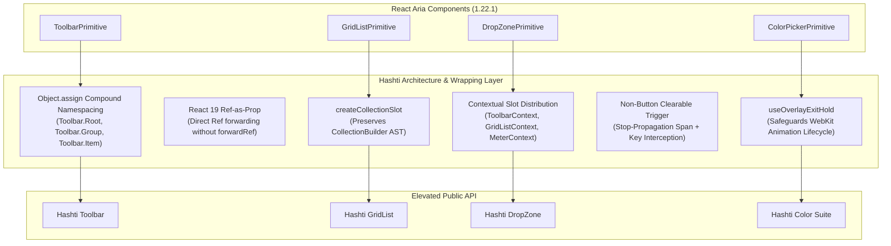
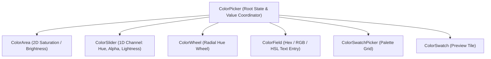

# RAC Component Expansion & Elevation Architecture Plan

## Hashti Design System · React Aria Components (RAC 1.22.1) Elevation Roadmap

> **Author:** Hashti Design System Architecture Team  
> **Target Version:** `react-aria-components@1.22.1`, `react@19.3.1`, `@cinder/tokens` (Carbon + Relay + Frame)  
> **Status:** Approved Architectural Roadmap  
> **Date:** November 2026

---

## 1. Executive Summary & Mission Overview

Hashti (built on the Cinder core engine) has established a robust design system foundation combining **Carbon Design System's** disciplined enterprise geometry and tokens, **React Aria Components' (RAC 1.22.1)** rock-solid W3C WAI-ARIA behavioral models, and **Frame's** brand aesthetic.

Currently, Hashti exports **45 component families** in `packages/react/src/index.ts` (cataloged in `apps/docs/src/catalog.ts`). While fundamental form fields, buttons, overlays, and basic tables are elevated into cohesive Hashti components, an audit of `react-aria-components@1.22.1` reveals **over 25 first-class primitives, hooks, and architectural capabilities** that are currently:

1. Re-exported raw without Hashti styling, tokens, or compound ergonomics (e.g., `GridList`, `Tree`, `Toolbar`, `Disclosure`, `DropZone`, `ListBox`).
2. Confined inside monolithic composite wrappers without granular part access (e.g., `DropZone` trapped inside `FileUploader`, `Meter` implemented without threshold semantics).
3. Completely omitted from Hashti's public export barrel despite high utility for creative and enterprise workflows (e.g., the complete **Color Primitives Suite**, RAC 1.22 **Sheet**, RAC 1.21 **NavigationTree**, and `@react-aria/virtualizer` integration).

By adopting the **HeroUI v3 RAC wrapping craftsmanship**—notably React 19 ref-as-prop compound namespacing (`Object.assign`), contextual compound slot distribution, defensive exit animation handling (`useOverlayExitHold`), non-nested clearable triggers, and collection slot injection—Hashti can systematically elevate these primitives into enterprise-grade components.

This document establishes the **RAC Component Expansion Plan**: a definitive gap matrix, architectural blueprints for high-priority candidates, token bindings, keyboard contracts, and a phased rollout roadmap.

---

## 2. RAC 1.22.1 Primitives vs. Hashti Catalog Gap Matrix

The following matrix compares every component primitive provided by `react-aria-components@1.22.1` against the current Hashti catalog, classifying the elevation gap, business/UX value, implementation complexity, and target rollout phase.

### Status Legend

- 🟢 **Elevated**: First-class Hashti component with custom tokens, BEM classes (`cinder-*`), Frame theme support, and documented API.
- 🟡 **Raw Re-export**: Exported verbatim from RAC in `packages/react/src/index.ts` with minimal or base `react-aria-*` styling.
- 🟠 **Internal/Monolithic**: Buried inside a convenience wrapper with no standalone API.
- 🔴 **Missing**: Available in RAC 1.22.1 but not exported or exposed by Hashti.

| RAC 1.22.1 Primitive / Suite       | Current Status   | Elevation Gap & Limitations                                                                                                                                                          | Value Tier                | Complexity | Target Phase |
| ---------------------------------- | ---------------- | ------------------------------------------------------------------------------------------------------------------------------------------------------------------------------------ | ------------------------- | ---------- | ------------ |
| **ColorPicker**                    | 🔴 Missing       | Entire color suite is missing from Hashti exports. No top-level color coordinator.                                                                                                   | High (Creative/Studio)    | Medium     | Phase 5      |
| **ColorArea**                      | 🔴 Missing       | 2D saturation/brightness/value picker. Zero support currently.                                                                                                                       | High                      | Medium     | Phase 5      |
| **ColorSlider**                    | 🔴 Missing       | 1D channel slider (Hue, Alpha, Lightness) with gradient tracks. Zero support.                                                                                                        | High                      | Low        | Phase 5      |
| **ColorField**                     | 🔴 Missing       | Text input for Hex, RGB, HSL, HSB with native color parsing. Zero support.                                                                                                           | High                      | Low        | Phase 5      |
| **ColorWheel**                     | 🔴 Missing       | Radial hue color wheel with circular drag thumb. Zero support.                                                                                                                       | Medium                    | Medium     | Phase 5      |
| **ColorSwatch**                    | 🔴 Missing       | Visual color preview tile with transparency checkerboard. Zero support.                                                                                                              | High                      | Low        | Phase 5      |
| **ColorSwatchPicker**              | 🔴 Missing       | Grid/palette of selectable swatches with keyboard navigation. Zero support.                                                                                                          | High                      | Low        | Phase 5      |
| **ColorThumb**                     | 🔴 Missing       | Draggable color thumb handle with high-contrast ring for all color controls.                                                                                                         | High                      | Low        | Phase 5      |
| **GridList / GridListItem**        | 🟡 Raw Re-export | Exported raw. Mentioned in docs as `contained-list`, but lacks elevated compound API, drag-and-drop handles, selection checkboxes, and load-more.                                    | **Critical** (Data)       | High       | Phase 4      |
| **Tree / TreeItem**                | 🟡 Raw Re-export | Exported raw. Mentioned in docs as `tree-view`, but lacks visual tree guides, animated chevrons, selection checkboxes, and async branch expansion.                                   | **Critical** (Navigation) | High       | Phase 4      |
| **NavigationTree**                 | 🔴 Missing       | Added in RAC 1.21 for hierarchical site/docs navigation. Missing from index.                                                                                                         | Medium                    | Medium     | Phase 4      |
| **ListBox / ListBoxItem**          | 🟡 Raw Re-export | Used internally by `Select` and `ComboBox`. No elevated standalone component for dual-list pickers, command palettes, or settings lists.                                             | High                      | Low        | Phase 3      |
| **Toolbar**                        | 🟡 Raw Re-export | Exported raw. No elevated accessible tool strip with roving tabIndex, button group wrapping, separator, or toggle integration.                                                       | **Critical** (Workspace)  | Medium     | Phase 3      |
| **Disclosure / DisclosurePanel**   | 🟡 Raw Re-export | Used internally only inside `Accordion`. No standalone elevated single collapsible panel for "Advanced Settings" or collapsible cards.                                               | **Critical** (Layout)     | Low        | Phase 3      |
| **DropZone**                       | 🟠 Monolithic    | Trapped inside `FileUploader`. Cannot be used independently for dropping content (canvas drops, table row drops, custom cards).                                                      | High (Workflow)           | Low        | Phase 3      |
| **FileTrigger**                    | 🟠 Monolithic    | Trapped inside `FileUploader`. Cannot be attached to an arbitrary custom trigger (e.g. "Upload Avatar" button or link).                                                              | High (Workflow)           | Low        | Phase 3      |
| **Meter**                          | 🟡 Partial       | Thin wrapper in `feedback.tsx` identical to `ProgressBar`. Completely missing semantic threshold ranges (`low`, `high`, `optimum`), warning/critical colors, and storage breakdowns. | High (Status)             | Low        | Phase 3      |
| **Sheet**                          | 🔴 Missing       | Newly introduced in RAC 1.22.0. Official mobile bottom sheet / sliding panel with snap points and velocity gesture physics. Current `Drawer` is custom modal.                        | High (Mobile/Responsive)  | High       | Phase 4      |
| **TableLoadMoreItem**              | 🟡 Raw Re-export | Exported raw. Hashti `Table` lacks infinite scrolling load-more trigger and skeleton indicator.                                                                                      | Medium                    | Low        | Phase 4      |
| **ColumnResizer / ResizableTable** | 🟡 Raw Re-export | Exported raw. Resizing works at CSS level but lacks elevated visual handle, snap points, and minimum constraints.                                                                    | Medium                    | Medium     | Phase 4      |
| **Virtualizer**                    | 🔴 Missing       | Built-in `@react-aria/virtualizer` in RAC 1.22.1 (`ListLayout`, `TableLayout`, `GridLayout`). Not integrated into Hashti for 10,000+ item rendering.                                 | High (Scale)              | High       | Phase 5      |
| **PreviewTrigger**                 | 🔴 Missing       | RAC 1.20 hover/focus context preview primitive (HoverCard). Missing from Hashti.                                                                                                     | Medium                    | Medium     | Phase 4      |
| **TokenField / TokenInput**        | 🔴 Missing       | RAC 1.20 experimental chip/tag input field (multi-email, search tags). Missing.                                                                                                      | High (Inputs)             | High       | Phase 5      |
| **Autocomplete**                   | 🔴 Missing       | RAC 1.22 low-level autocomplete primitive. Missing from index.                                                                                                                       | Medium                    | Medium     | Phase 4      |
| **RangeCalendar** (Standalone)     | 🟢 Elevated      | Implemented in `dates.tsx`, but lacks dual-month rendering and standard date range quick presets (Today, 7D, 30D, MTD, YTD).                                                         | Medium                    | Low        | Phase 3      |

---

## 3. HeroUI v3 Architectural Patterns to Adopt in Hashti

To elevate these primitives with enterprise craftsmanship, Hashti adopts the following architectural patterns established in HeroUI v3:



### 3.1 Compound Component Namespacing (`Object.assign`) & React 19 Ref-as-Prop

- **No `forwardRef`:** React 19 treats `ref` as an ordinary prop. All wrappers accept `{ ref, ...props }` directly, preventing unnecessary runtime wrapper components.
- **Ergonomic Subcomponent Namespacing:** Following HeroUI v3, components provide both standalone named exports and namespaced properties on the root component:
  ```tsx
  export const Toolbar = Object.assign(ToolbarRoot, {
    Root: ToolbarRoot,
    Group: ToolbarGroup,
    Item: ToolbarItem,
    Separator: ToolbarSeparator,
  });
  ```
- **Consistent Export Surface:** Consumers can choose either `<Toolbar.Group>` or import `{ ToolbarGroup }` based on their linting and architectural conventions.

### 3.2 Contextual Compound Slot Distribution

Instead of passing props (`size`, `variant`, `isDisabled`, `orientation`) down through manual JSX trees, root components create a typed React Context (`ToolbarContext`, `GridListContext`, `MeterContext`) that automatically coordinates child states:

```tsx
interface ToolbarContextValue {
  size?: ControlSize;
  orientation?: "horizontal" | "vertical";
  isDisabled?: boolean;
}
const ToolbarContext = createContext<ToolbarContextValue>({});
```

Child items (`ToolbarItem`, `ToolbarGroup`) consume this context and automatically inherit the container's control height and layout constraints.

### 3.3 Defensive Exit Animation Lifecycle (`useOverlayExitHold`)

When closing portalled overlays (ColorPicker popovers, Sheet slide-overs, Tooltips), Safari/WebKit suffers from layout-effect race conditions where CSS animations are evaluated in a `pending` state during DOM removal, causing instant unmounting or an 1-frame opacity flash (`opacity: 1`).
Hashti will adopt `useOverlayExitHold`:

1. Holds `isExiting = true` when `isOpen` transitions to `false`.
2. Probes DOM animation states via `element.getAnimations({ subtree: true })`.
3. Sets up `animationend`/`animationcancel` event listeners with a safety timeout (`duration + 50ms`).
4. Executes `element.style.opacity = "0"` before unmounting and synchronizes removal via `flushSync`, guaranteeing zero-flicker transitions.

### 3.4 Bypassing RAC CollectionBuilder Restrictions (`createCollectionSlot`)

RAC collection primitives (`GridList`, `Tree`, `ListBox`) use an AST-like `CollectionBuilder` that inspects direct children. Inserting decorative layout elements (e.g. custom scroll containers or sticky headers) can break collection registration.

- Hashti uses RAC's `Collection` element and slotted render channels to inject chrome without breaking keyboard navigation trees.

### 3.5 Accessible Clearable Pattern (Non-Nested Buttons)

When providing clear or remove actions inside interactive controls (SearchField, Select, FilterTag):

- Never nest a `<button>` inside another interactive trigger (violates HTML5 spec and confuses accessibility screen readers).
- Render a `<span role="presentation" tabIndex={-1}>` with `onPointerDown={(e) => e.stopPropagation()}` to prevent triggering the parent.
- Intercept `Backspace` and `Delete` on the parent trigger to execute clearing via keyboard.

### 3.6 Multi-Theme Layering & SSR-Safe ID Isolation

- All new components bind to Hashti's 8 theme classes (`white`, `g10`, `g90`, `g100`, `relay-light`, `relay-dark`, `frame-light`, `frame-dark`).
- Support contextual layer level elevation (`layer-0`, `layer-1`, `layer-2`).
- Use React 19's native `useId()` for all aria-labelledby and aria-describedby associations, ensuring zero hydration mismatches.

---

## 4. Component Specifications for Top Expansion Candidates

---

### Candidate 1: `GridList` (Contained Interactive List)

#### 1. Motivation & Carbon Alignment

`GridList` represents Carbon's **ContainedList** elevated to RAC's full accessible grid model. While Carbon's ContainedList uses basic document navigation, Hashti's `GridList` provides roving arrow-key navigation, multi-item selection with checkboxes, keyboard item reordering, drag-and-drop handles, and infinite scroll load-more.

#### 2. Component Anatomy & Subcomponents

```
<GridList>                          <!-- Root collection container -->
  <GridList.Header>                 <!-- Optional title & action bar -->
  <GridList.Item>                   <!-- Interactive row item -->
    <GridList.DragHandle />         <!-- Drag grip handle for DND -->
    <GridList.Checkbox />           <!-- Accessible selection checkbox -->
    <GridList.Content />            <!-- Main label & secondary text -->
    <GridList.Actions />            <!-- Row-level contextual buttons -->
  </GridList.Item>
  <GridList.LoadMore />             <!-- Infinite scroll trigger -->
  <GridList.EmptyState />           <!-- Zero-state placeholder -->
</GridList>
```

#### 3. RAC Primitives Wrapped

- `react-aria-components`: `GridList`, `GridListItem`, `GridListSection`, `GridListHeader`, `Button slot="drag"`, `Checkbox slot="selection"`, `useDragAndDrop`, `DropIndicator`.

#### 4. Props Interface

```tsx
export interface GridListProps<T extends object> extends Omit<RACGridListProps<T>, "className"> {
  size?: "sm" | "md" | "lg"; // 36px, 44px, 56px row height
  variant?: "flat" | "bordered" | "card"; // Visual surface style
  selectionMode?: "none" | "single" | "multiple";
  onAction?: (key: Key) => void;
  renderEmptyState?: () => ReactNode;
  dragAndDropHooks?: DragAndDropHooks; // useDragAndDrop hook output
  className?: string | ((values: GridListRenderProps) => string);
  ref?: Ref<HTMLDivElement>;
}

export interface GridListItemProps<T extends object> extends Omit<
  RACGridListItemProps<T>,
  "className"
> {
  textValue?: string;
  className?: string | ((values: GridListItemRenderProps) => string);
  ref?: Ref<HTMLDivElement>;
}
```

#### 5. Hashti Token & Theme Bindings

- **Row Height:** `sm: 36px`, `md: 44px (Frame standard)`, `lg: 56px`.
- **Backgrounds:** Resting: `var(--cinder-surface)`; Hover: `var(--cinder-raised)`; Selected: `var(--cinder-selected)`.
- **Border:** `1px solid var(--cinder-divider)`.
- **Focus Ring:** `2px solid var(--cinder-focus)`, `outline-offset: -2px`.
- **Drag Target Indicator:** `2px solid var(--cinder-focus)` with glowing drop line.

#### 6. Accessibility & Keyboard Contract

- Role: `grid` with `row` and `gridcell`.
- **Arrow Up / Down:** Move focus across rows.
- **Space:** Toggle row selection.
- **Ctrl/Cmd + A:** Select all items (in `multiple` mode).
- **Alt + Arrow Up / Down:** Reorder items when drag-and-drop is active.

---

### Candidate 2: `Tree` / `TreeView` (Hierarchical Navigation & Data)

#### 1. Motivation & Carbon Alignment

Hierarchical data (file directories, organization charts, nested navigation, JSON inspectors) requires a dedicated tree control. Hashti currently exports RAC `Tree` raw. Elevating `Tree` brings Carbon's TreeView visual design together with RAC's robust treegrid accessibility.

#### 2. Component Anatomy

```
<Tree>                               <!-- Treegrid root container -->
  <Tree.Item>                        <!-- Node item with level depth -->
    <Tree.ExpandButton>              <!-- Chevron expand/collapse toggle -->
      <Icon name="chevronRight" />
    </Tree.ExpandButton>
    <Tree.Checkbox />                <!-- Selection checkbox -->
    <Tree.Icon />                    <!-- File/Folder icon slot -->
    <Tree.Content>README.md</Tree.Content>
    <Tree.Actions />                 <!-- Inline actions -->
  </Tree.Item>
</Tree>
```

#### 3. RAC Primitives Wrapped

- `react-aria-components`: `Tree`, `TreeItem`, `TreeItemContent`, `TreeSection`, `Button slot="expand"`, `Checkbox slot="selection"`.

#### 4. Props Interface

```tsx
export interface TreeProps<T extends object> extends Omit<RACTreeProps<T>, "className"> {
  size?: "sm" | "md"; // 32px or 40px node height
  showGuideLines?: boolean; // Connect branches with subtle vertical lines
  selectionMode?: "none" | "single" | "multiple";
  expandedKeys?: Iterable<Key>;
  defaultExpandedKeys?: Iterable<Key>;
  onExpandedChange?: (keys: Set<Key>) => void;
  className?: string | ((values: TreeRenderProps) => string);
  ref?: Ref<HTMLDivElement>;
}

export interface TreeItemProps<T extends object> extends Omit<RACTreeItemProps<T>, "className"> {
  title?: ReactNode;
  icon?: IconName | ReactNode;
  className?: string | ((values: TreeItemRenderProps) => string);
  ref?: Ref<HTMLDivElement>;
}
```

#### 5. Hashti Token & Theme Bindings

- **Indentation Guide:** `border-inline-start: 1px solid var(--cinder-divider)`.
- **Expand Chevron:** Smooth 90deg CSS rotation transition: `transform 150ms cubic-bezier(0.2, 0, 0.38, 0.9)`.
- **Selected Node:** `background: var(--cinder-selected)`, `color: var(--cinder-primary)`.
- **Hover Node:** `background: var(--cinder-raised)`.

#### 6. Accessibility & Keyboard Contract

- Role: `treegrid` (or `tree`).
- **Arrow Down / Up:** Move between visible nodes.
- **Arrow Right:** Expand collapsed node; if already expanded, moves to first child.
- **Arrow Left:** Collapse expanded node; if already collapsed, moves to parent node.
- **Home / End:** Move to top / bottom node.
- **Typeahead:** Typing matches node labels directly.

---

### Candidate 3: `Toolbar` (Accessible Command & Tool Strip)

#### 1. Motivation & Carbon Alignment

Productivity tools, rich-text editors, data table headers, and dashboard widgets require toolbars with multiple actions (buttons, toggle buttons, segmented switches, dropdown menus). A plain flex `<div>` creates multiple tab stops, requiring excessive keyboard navigation. Hashti's `Toolbar` implements the WAI-ARIA Toolbar pattern with roving tabIndex: the entire toolbar is a **single Tab stop**, and arrow keys navigate between controls.

#### 2. Component Anatomy

```
<Toolbar>                           <!-- Roving tabIndex container -->
  <Toolbar.Group>                   <!-- Logical cluster (e.g. formatting) -->
    <ToggleButton />
    <ToggleButton />
  </Toolbar.Group>
  <Toolbar.Separator />             <!-- Vertical divider -->
  <Toolbar.Group>
    <Select />
    <Button />
  </Toolbar.Group>
</Toolbar>
```

#### 3. RAC Primitives Wrapped

- `react-aria-components`: `Toolbar`, `Group`, `Separator`.

#### 4. Props Interface

```tsx
export interface ToolbarProps extends Omit<RACToolbarProps, "className"> {
  size?: ControlSize; // Propagated to child buttons/selects
  orientation?: "horizontal" | "vertical";
  variant?: "flat" | "raised" | "floating";
  className?: string | ((values: ToolbarRenderProps) => string);
  ref?: Ref<HTMLDivElement>;
}

export interface ToolbarGroupProps extends ComponentProps<"div"> {
  ariaLabel?: string;
  ref?: Ref<HTMLDivElement>;
}

export interface ToolbarSeparatorProps extends ComponentProps<"hr"> {
  ref?: Ref<HTMLHRElement>;
}
```

#### 5. Hashti Token & Theme Bindings

- **Floating Surface:** `background: var(--cinder-surface)`, `box-shadow: 0 4px 16px rgba(0,0,0,0.12)`, `border-radius: 8px`.
- **Separator:** `width: 1px`, `height: 20px`, `background: var(--cinder-divider)`, `margin: 0 6px`.
- **Inner Items:** Flush margins, integrated active and focus states.

#### 6. Accessibility & Keyboard Contract

- Role: `toolbar`.
- **Tab / Shift+Tab:** Enters and exits the toolbar as a single tab stop, landing on the last focused control.
- **Arrow Right / Left (or Up/Down):** Moves focus between controls, wrapping around if enabled.
- **Home / End:** Moves focus to the first / last control in the toolbar.

---

### Candidate 4: `Disclosure` & `DisclosureGroup` (Standalone Collapsibles)

#### 1. Motivation

Currently, Hashti only provides `Accordion` in `collections.tsx`, requiring an array/group structure. Frequently, applications require a **standalone collapsible region**—for instance:

- "Show advanced settings" in a form.
- Collapsible query breakdown in analytics.
- Expandable card details.
  Providing standalone `Disclosure` fills this gap cleanly.

#### 2. Component Anatomy

```
<Disclosure>                        <!-- Collapsible controller -->
  <Disclosure.Trigger>              <!-- Button with chevron & state -->
    <span>Advanced Options</span>
    <Disclosure.Indicator />
  </Disclosure.Trigger>
  <Disclosure.Panel>                <!-- Animated expand/collapse body -->
    <TextField label="API Endpoint" />
  </Disclosure.Panel>
</Disclosure>
```

#### 3. RAC Primitives Wrapped

- `react-aria-components`: `Disclosure`, `DisclosurePanel`, `Heading`, `Button slot="trigger"`.

#### 4. Props Interface

```tsx
export interface DisclosureProps extends Omit<RACDisclosureProps, "className"> {
  isExpanded?: boolean;
  defaultExpanded?: boolean;
  onExpandedChange?: (isExpanded: boolean) => void;
  size?: ControlSize;
  variant?: "default" | "card" | "flush";
  className?: string | ((values: DisclosureRenderProps) => string);
  ref?: Ref<HTMLDivElement>;
}

export interface DisclosureTriggerProps extends ComponentProps<typeof Button> {
  headingLevel?: 1 | 2 | 3 | 4 | 5 | 6;
}

export interface DisclosurePanelProps extends ComponentProps<typeof RACDisclosurePanel> {
  ref?: Ref<HTMLDivElement>;
}
```

#### 5. Hashti Token & Theme Bindings

- **Indicator:** 16px chevron rotating 90deg on expansion.
- **Panel Transition:** Zero-JS CSS grid animation (`grid-template-rows: 0fr -> 1fr`) ensuring smooth height transition without fixed pixel limits.
- **Border:** `border-bottom: 1px solid var(--cinder-divider)`.

---

### Candidate 5: Standalone `DropZone` & Unified `FileTrigger`

#### 1. Motivation

Hashti has `FileUploader` (`files.tsx`), but it is an all-in-one component. Enterprise apps frequently require:

- A custom canvas drop zone (e.g., dropping CSV files into a data table).
- An avatar trigger where clicking the avatar opens a file chooser (`FileTrigger` wrapping `<Avatar>`).
- Standalone file drop targets with visual drag-over feedback.

#### 2. Component Anatomy

```
<DropZone>                          <!-- Drop target container -->
  <DropZone.VisualFeedback />       <!-- Drag-over glow/dashed border -->
  <FileTrigger>                     <!-- Invisible file picker connector -->
    <Button variant="secondary">Browse files</Button>
  </FileTrigger>
  <Text>or drag and drop your file here</Text>
</DropZone>
```

#### 3. RAC Primitives Wrapped

- `react-aria-components`: `DropZone`, `FileTrigger`, `DropIndicator`, `isFileDropItem`.

#### 4. Props Interface

```tsx
export interface DropZoneProps extends Omit<RACDropZoneProps, "className"> {
  variant?: "dashed" | "solid" | "card";
  onDropFiles?: (files: File[]) => void;
  className?: string | ((values: DropZoneRenderProps) => string);
  ref?: Ref<HTMLDivElement>;
}

export interface FileTriggerProps extends RACFileTriggerProps {
  children: ReactNode;
}
```

#### 5. Hashti Token & Theme Bindings

- **Dashed Border:** `2px dashed var(--cinder-divider)`.
- **Drag-Over Active:** `background: var(--cinder-infoSurface)`, `border-color: var(--cinder-focus)`, `transform: scale(1.005)`.
- **Invalid Drop (Rejection):** `background: var(--cinder-errorSurface)`, `border-color: var(--cinder-error)`.

---

### Candidate 6: Enhanced `Meter` (Semantic Range & Threshold Gauge)

#### 1. Motivation & Carbon Alignment

While `ProgressBar` represents progress towards completion over time, `Meter` represents a **static quantity within a known range** (e.g. disk space, memory utilization, battery level, password strength, credit score). Hashti's current `Meter` is a clone of `ProgressBar`. The elevated `Meter` implements semantic threshold coloring:

- **Low / High / Optimum Thresholds:** Automatically shifts color from `success` (green) to `warning` (amber) to `error` (red) based on whether higher or lower values are optimal.
- **Segmented / Breakdown Meters:** Supports multi-channel fill (e.g. 40GB system, 30GB apps, 10GB free).

#### 2. Component Anatomy

```
<Meter value={85} minValue={0} maxValue={100} low={60} high={80} optimum={30}>
  <Meter.Label>Storage Space</Meter.Label>
  <Meter.Value />                   <!-- e.g. "85%" or "85 GB of 100 GB" -->
  <Meter.Track>
    <Meter.Fill />                  <!-- Color dynamically bound to threshold -->
  </Meter.Track>
  <Meter.HelperText>Running low on disk space</Meter.HelperText>
</Meter>
```

#### 3. Props Interface

```tsx
export interface MeterProps extends Omit<RACMeterProps, "className"> {
  label?: ReactNode;
  helperText?: ReactNode;
  formatOptions?: Intl.NumberFormatOptions;
  low?: number; // Lower threshold boundary
  high?: number; // Upper threshold boundary
  optimum?: number; // Optimal operating point
  tone?: "auto" | "neutral" | "success" | "warning" | "error"; // Force tone or derive
  segments?: Array<{ value: number; color: string; label: string }>; // Multi-segment
  size?: "sm" | "md" | "lg"; // 4px, 8px, 12px track
  ref?: Ref<HTMLDivElement>;
}
```

#### 4. Hashti Token & Theme Bindings

- **Success Tone:** `var(--cinder-success)` (`#246343` / `#a4d9b8`).
- **Warning Tone:** `var(--cinder-warning)` (`#75500d` / `#e7c383`).
- **Error Tone:** `var(--cinder-error)` (`#aa2735` / `#ffacb3`).
- **Track Surface:** `var(--cinder-raised)`.

---

### Candidate 7: The Color Primitives Suite (Creative & Studio Tools)

#### 1. Motivation

Modern web tools require robust, accessible color manipulation: theme editors, diagram styling, dashboard visualization palettes, and design tokens. RAC 1.22.1 provides an industry-leading W3C-compliant suite of color primitives with full keyboard arrow manipulation, screen reader channel announcements, and high-contrast color math. Hashti currently exports **none** of these.

#### 2. Component Suite & Roles



#### 3. Detailed Color Subcomponents

1. **`ColorPicker`**: Container coordinating color state, supporting both inline and popover trigger modes.
2. **`ColorArea`**: 2D gradient surface with draggable `ColorThumb` for simultaneously adjusting two channels (e.g., Saturation + Brightness).
3. **`ColorSlider`**: 1D gradient track with `ColorThumb` for adjusting a single channel (Hue, Alpha, Red, Green, Blue).
4. **`ColorWheel`**: Circular 360° hue selector with radial thumb positioning.
5. **`ColorField`**: Form field with label, error, and specialized color input that parses typed Hex, RGB, or HSL strings and adjusts step values.
6. **`ColorSwatch`**: Visual square previewing color with an underlying checkered alpha background for transparent colors.
7. **`ColorSwatchPicker`**: Accessible grid of pre-defined palette swatches with arrow-key navigation.

#### 4. Hashti Token & Theme Bindings

- **Color Thumb:** 20px circle with `border: 2px solid #ffffff`, `box-shadow: 0 0 0 1px rgba(0,0,0,0.4), 0 2px 4px rgba(0,0,0,0.2)`.
- **Alpha Checkerboard:** CSS `conic-gradient(#808080 90deg, #c0c0c0 90deg 180deg, #808080 180deg 270deg, #c0c0c0 270deg)`.
- **Focus Ring:** `2px solid var(--cinder-focus)`, offset 2px.

#### 5. Accessibility & Keyboard Contract

- **ColorArea:**
  - Arrow Up/Down: Adjust Y channel (e.g. Brightness) by 1 step.
  - Arrow Left/Right: Adjust X channel (e.g. Saturation) by 1 step.
  - Page Up / Page Down: Adjust channels by 10 steps.
- **ColorSlider & ColorWheel:**
  - Arrow Left/Right or Down/Up: Rotate or slide through channel values.
  - Home / End: Snap to min / max channel bound.
- **Screen Reader Announcements:** Formatted color descriptions (e.g., "Hue: 215 degrees", "Saturation: 80%").

---

### Candidate 8: `Sheet` (RAC 1.22 Mobile & Responsive Bottom Sheet)

#### 1. Motivation

RAC 1.22 introduced `Sheet` (`SheetTrigger`, `SheetOverlay`, `SheetContent`, `SheetBackdrop`), a dedicated sliding sheet primitive with snap points, gesture velocity tracking, and responsive drawer transitions. While Hashti built a custom `Drawer` in `drawer.tsx` using `ModalOverlay`, `Sheet` provides native touch-drag dismiss, stacked card scale-down, and mobile bottom-sheet ergonomics.

#### 2. Component Anatomy

```
<SheetTrigger>
  <Button>View Order Summary</Button>
  <Sheet placement="bottom" snapPoints={[0.4, 0.9]}>
    <Sheet.Backdrop />
    <Sheet.Content>
      <Sheet.Handle />              <!-- Visual drag bar -->
      <Sheet.Header>Order Details</Sheet.Header>
      <Sheet.Body>...</Sheet.Body>
    </Sheet.Content>
  </Sheet>
</SheetTrigger>
```

---

### Candidate 9: `Virtualizer` (Large Collection Performance Engine)

#### 1. Motivation

Enterprise data grids and activity feeds frequently need to render 5,000 to 100,000 rows without degrading memory or frame rates. RAC 1.22.1 includes `@react-aria/virtualizer` primitives:

- `Virtualizer`: Virtual container.
- `ListLayout`: 1D virtual list layout for `ListBox` and `GridList`.
- `TableLayout`: 2D virtual grid layout for `Table`.
- `GridLayout` & `WaterfallLayout`: 2D masonry and card layouts.

#### 2. Integration with Hashti Table & GridList

```tsx
import { Virtualizer, TableLayout } from "react-aria-components";

<Virtualizer layout={TableLayout}>
  <Table aria-label="Large Data Set">{/* Virtualized rows loaded on demand */}</Table>
</Virtualizer>;
```

Hashti will elevate this with pre-configured layouts (`virtualized` prop on `Table` and `GridList`), removing boilerplate for consumers.

---

## 5. Phased Rollout Roadmap

The expansion plan is structured into three clear execution phases, maintaining backward compatibility with the existing 45 catalog components while systematically delivering new capabilities.

```mermaid
timeline
    title Hashti RAC Component Expansion Roadmap
    section Phase 3 : Immediate High-Impact
        Toolbar Suite : Roving tabIndex, Group, Separator
        Standalone Disclosure : Single collapsible, animated height
        DropZone & FileTrigger : Decoupled file ingestion
        Enhanced Meter : Semantic threshold ranges, storage gauges
        Standalone ListBox : Multi-select pickers, command palettes
        RangeCalendar Presets : Quick date ranges (Today, 7D, 30D)
    section Phase 4 : Data & Productivity
        GridList Suite : Interactive list, selection, DND reorder
        Tree & TreeView : Hierarchical treegrid, branch lines
        NavigationTree : Site & documentation tree navigation
        Sheet : Mobile bottom sheet, gesture snap points
        Table Infinite Scroll : TableLoadMoreItem, column resize handles
        PreviewTrigger : HoverCard preview popover
    section Phase 5 : Creative & Scale
        Color Primitives Suite : ColorPicker, ColorArea, Slider, Wheel, Swatch
        Virtualizer Engine : 10,000+ row rendering for Table & GridList
        TokenField : Multi-chip tag input field
        SharedElement Transitions : View transitions integration
```

### Phase 3: Immediate High-Impact Controls (Foundation & Utilities)

- **Target Components:**
  1. `Toolbar` (`Toolbar.Root`, `Toolbar.Group`, `Toolbar.Item`, `Toolbar.Separator`)
  2. `Disclosure` & `DisclosureGroup` (standalone collapsible)
  3. `DropZone` & `FileTrigger` (decoupled from FileUploader)
  4. `Meter` (elevated with threshold bands: `low`, `high`, `optimum`, tone derive)
  5. `ListBox` (elevated standalone collection with selection & keyboard navigation)
  6. `RangeCalendar` Presets (Today, Last 7 Days, Last 30 Days, MTD, YTD)
- **Primary Deliverables:**
  - Component TSX files in `packages/react/src/`.
  - CSS module / BEM rules in `packages/react/src/styles.css` bound to `--cinder-*` tokens.
  - Storybook stories for each component across all 8 themes.
  - Additions to `apps/docs/src/catalog.ts` and documentation website.

### Phase 4: Advanced Data & Productivity Workflows

- **Target Components:**
  1. `GridList` (interactive list with selection checkboxes, DND reordering, load-more)
  2. `Tree` / `TreeView` (hierarchical treegrid with chevrons, guide lines, selection)
  3. `NavigationTree` (documentation & site navigation)
  4. `Sheet` (mobile bottom sheet with touch gestures & snap points)
  5. `Table` Infinite Scroll (`TableLoadMoreItem`) & Resizable Container
  6. `PreviewTrigger` (HoverCard contextual preview)
- **Primary Deliverables:**
  - Drag-and-drop integration (`useDragAndDrop` with visual drop indicators).
  - Tree node keyboard traversal verification.
  - Touch gesture handling and velocity physics.

### Phase 5: Creative Color Suite & Performance Virtualization

- **Target Components:**
  1. Complete **Color Primitives Suite** (`ColorPicker`, `ColorArea`, `ColorSlider`, `ColorField`, `ColorWheel`, `ColorSwatch`, `ColorSwatchPicker`, `ColorThumb`)
  2. `Virtualizer` Integration for `Table`, `GridList`, and `ListBox`
  3. `TokenField` (multi-chip tag entry input)
  4. `SharedElement` & `SharedElementTransition` (View Transitions API integration)
- **Primary Deliverables:**
  - Color parsing and conversions (`parseColor`, `getColorChannels`).
  - High-performance virtual DOM recycling.
  - 100,000-item stress test benchmarks.

---

## 6. Testing, Accessibility Verification & Quality Gates

Every elevated component must satisfy Hashti's strict production verification gates before release:

### 6.1 Automated Accessibility Audits (`@axe-core/playwright`)

- **Zero Violations:** Clean sweep across `color-contrast`, `aria-roles`, `aria-allowed-attr`, `aria-required-children`, `nested-interactive`.
- **Explicit Live Regions:** Notifications, status changes, and drag-and-drop announcements must use polite live regions (`role="status"` / `aria-live="polite"`).

### 6.2 Strict Keyboard Interaction Matrix

| Component               | Mandatory Keyboard Sequences                                                                              |
| ----------------------- | --------------------------------------------------------------------------------------------------------- |
| **Toolbar**             | Single Tab stop. Arrow Left/Right to rove through items. Home/End to leap to boundaries.                  |
| **GridList**            | Arrow Down/Up to move rows. Space to select. Alt+Arrow to reorder items when DND is enabled.              |
| **Tree**                | Arrow Down/Up to traverse visible nodes. Arrow Right to expand. Arrow Left to collapse or jump to parent. |
| **Disclosure**          | Space or Enter toggles expansion. Tab enters panel contents.                                              |
| **ColorSlider / Wheel** | Arrow keys change channel value by 1 step. PageUp/PageDown change by 10 steps. Home/End snap to bounds.   |

### 6.3 Theme & Layer Conformance

- Every component must render cleanly across all **8 themes**:
  - Carbon: `white`, `g10`, `g90`, `g100`
  - Relay: `relay-light`, `relay-dark`
  - Frame: `frame-light`, `frame-dark`
- Seamless background and border adaptation across **3 layer levels** (`layer-0`, `layer-1`, `layer-2`).
- Windows High Contrast (Forced Colors) mode support (`forced-color-adjust: none` with explicit system canvas and highlight borders).

### 6.4 Browser & SSR Verification

- Verified across Chromium, WebKit (Safari), and Firefox.
- WebKit exit animation unmounting tested to prevent layout-effect flickers.
- SSR hydration verified using Bun test runners to guarantee zero hydration ID mismatch errors.

---

## 7. Conclusion & Next Steps

This expansion plan provides a clear, principled roadmap for unlocking the full power of React Aria Components 1.22.1 within Hashti. By combining RAC's world-class accessibility engine with HeroUI v3's compound component wrapping patterns and Hashti's refined design tokens, Hashti will expand from a solid form-and-table library into an all-encompassing enterprise and creative design system.

The immediate next step is the implementation of **Phase 3** (`Toolbar`, standalone `Disclosure`, decoupled `DropZone`/`FileTrigger`, and semantic `Meter`).
